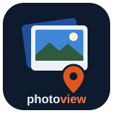

<p align="center">
  
</p>

<h1 align="center">PhotoView - Galeria</h1>

<p align="center">Suas fotos e vídeos em ordem, no mapa e em movimento. Tudo no seu navegador.</p>

## ⬇️ Baixar

<p align="center">
  <a href="https://github.com/LuccaBueno/photoview/releases/latest/download/photoview-galeria.html">
    
  </a>
  <a href="https://luccabueno.github.io/photoview/">
    
  </a>
</p>

1. Clique em **Baixar o PhotoView**. O arquivo `photoview-galeria.html` vai para a sua pasta Downloads.
2. Abra o arquivo com dois cliques. Ele abre no Chrome, Edge ou Opera.
3. Clique em **Pasta inteira** e escolha a pasta das suas fotos (por exemplo, `D:\Fotos`).

Não precisa instalar nada, e o Windows não mostra aviso de segurança, porque é só uma página.

> ⚠️ Não baixe "Source code (zip)" nem "Source code (tar.gz)": isso é o código-fonte para programadores, não o programa.

## O que ele faz

- **Linha do tempo** por anos, meses, dias ou momentos (como no Google Fotos)
- **Mapa** com todas as fotos, nomes de países e cidades, busca e vários estilos
- **Viagem no tempo**: um "filme" das suas fotos andando pelo mapa, de uma viagem, mês ou ano
- **Neste dia**: o que você fotografou nesta data em anos anteriores
- **Números**: viagens, países, cidades, câmeras, cópias repetidas e mais

Suas fotos **nunca são alteradas, copiadas ou enviadas**. Tudo acontece dentro do navegador.

---

## Perguntas comuns

**Minhas fotos vão para algum servidor?**
Não. O navegador só deixa a página ler os arquivos que você escolher, e a leitura acontece no seu computador.

**Funciona com pastas dentro de pastas?**
Sim. Todas as subpastas são lidas.

**E fotos sem data ou sem GPS?**
Sem data no arquivo, o PhotoView usa a data do nome (ex.: `IMG_20250114_093012.jpg`) ou a data de modificação. Fotos sem GPS recebem um **local estimado** pela foto mais próxima no tempo, marcado como estimado.

**A data de algumas fotos está errada.**
Na linha do tempo, clique em **Ajustar datas**, selecione as fotos e mova as datas. O arquivo original não muda. O ajuste fica salvo no navegador.

**Funciona no celular?**
Dá para abrir, mas escolher pastas inteiras funciona melhor no computador.

---

## Para desenvolvedores

O código fica em `src/` e é montado num único arquivo HTML.

```
src/photoview.html    estrutura e estilos da página
src/app.js            toda a lógica
data/                 mapa-múndi, cidades (GeoNames) e códigos de países
vendor/               CSS do Leaflet
scripts/build.py      monta index.html e dist/photoview-galeria.html
```

Para montar depois de editar:

```bash
python3 scripts/build.py
```

Depois abra `index.html` no navegador para testar.

### Publicar uma nova versão

1. Rode `python3 scripts/build.py` e faça o commit (o `index.html` atualiza o site).
2. Crie uma tag: `git tag v1.1 && git push --tags`
3. O GitHub Actions cria a página de Releases com o arquivo para baixar.

### Créditos

- Mapas: [Leaflet](https://leafletjs.com), [OpenStreetMap](https://www.openstreetmap.org/copyright), [CARTO](https://carto.com/attributions), [Esri](https://www.esri.com)
- Cidades: [GeoNames](https://www.geonames.org) (CC BY 4.0), via `all-the-cities`
- Contornos dos países: [Natural Earth](https://www.naturalearthdata.com), via `world-atlas`
- Leitura de EXIF: [exifr](https://github.com/MikeKovarik/exifr) · gráficos: [d3](https://d3js.org)

Licença: MIT.
